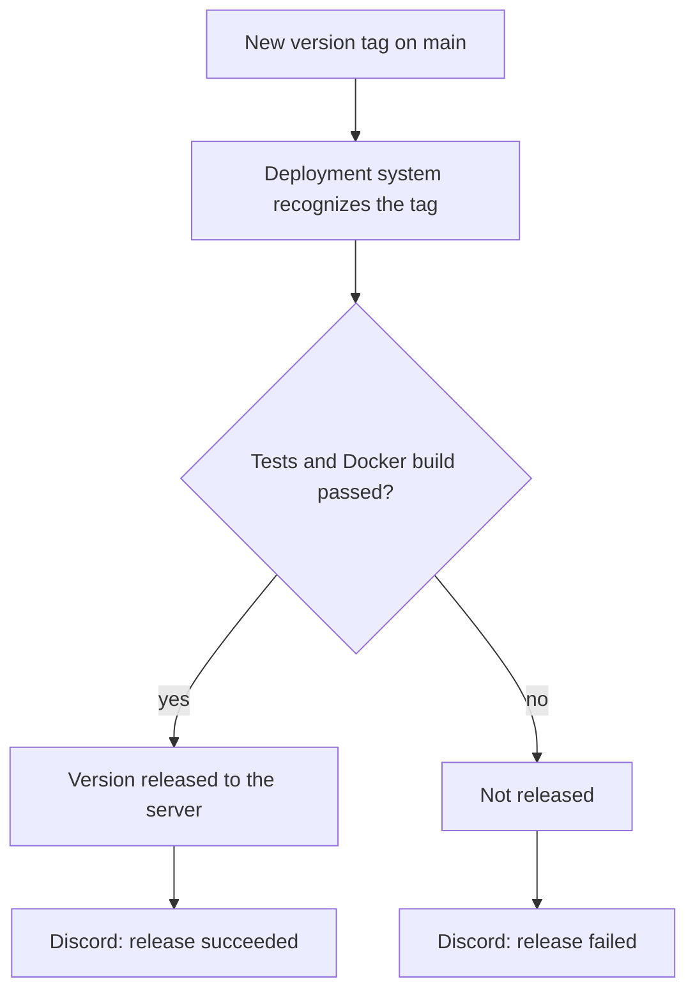

# tatou
A web platform for pdf watermarking. This project is intended for pedagogical use, and contain security vulnerabilities. Do not deploy on an open network.

## Instructions

The following instructions are meant for a bash terminal on a Linux machine. If you are using something else, you will need to adapt them.

To clone the repo, you can simply run:

```bash
git clone https://github.com/vihanga-bandara/g9-ss.git
```

### Run the tests

```bash
cd g9-ss/server

# Create a python virtual environment (the server needs Python 3.12)
python3 -m venv .venv

# Activate your virtual environment
. .venv/bin/activate

# Install the necessary dependencies
python -m pip install -e ".[dev]"

# Run the unit and API tests
python -m pytest
```

The API tests use Flask's test client, so no server or database needs to be running.

### Measure coverage

From `server/`, with the virtual environment active:

```bash
python -m coverage run -m pytest
python -m coverage report --show-missing
```

### Run mutation testing

mutmut plants small bugs in the code and reruns the tests to see whether they notice. From `server/` (Linux or WSL only):

```bash
mutmut run "auth_service*" "document_service*" "watermark_service*" "ghost_text*" "rmap_routes*" "auth.*"

# List the mutants that no test caught, then show one of them
mutmut results
mutmut show <name>
```

### Deploy

From the root of the directory:

```bash
# Edit .env and pick the passwords you want

# Rebuild the docker image and deploy the containers
docker compose up --build -d

# Monitor logs in realtime 
docker compose logs -f

# Test if the API is up
curl -i http://127.0.0.1:5000/healthz

# Open your browser at 127.0.0.1:5000 to check if the website is up.
```

### Create a new release

Create a new version tag on main and push it:

```bash
git checkout main && git pull
git tag -a v1.0.1 -m "Release v1.0.1"
git push origin v1.0.1
```

The deployment system recognizes the new tag and releases that version to the server, once the tests and the Docker build have passed on it. The team gets a Discord message when a release succeeds or fails.




